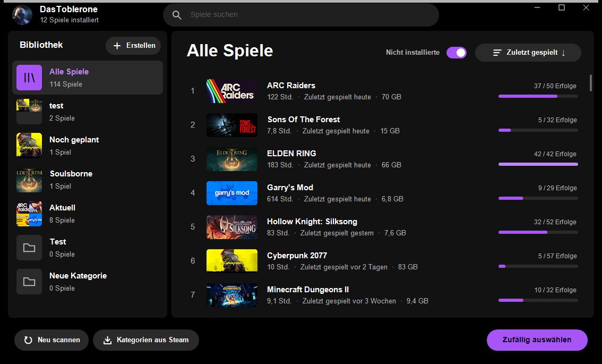
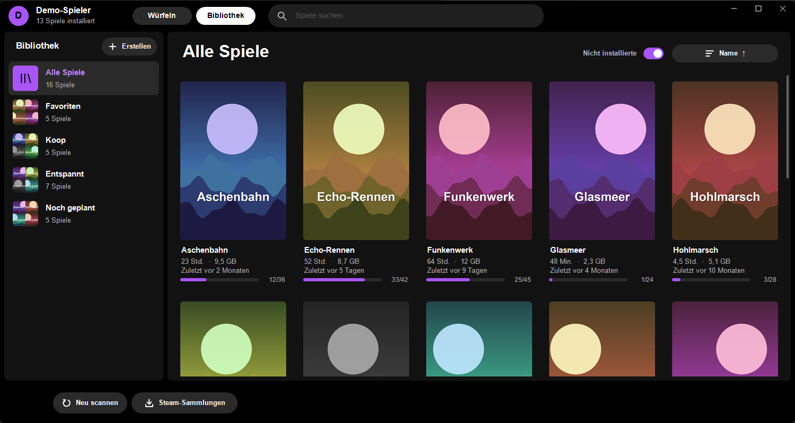

# PLAYR-Launcher

Eine kleine Windows-App, die deine installierten Steam-Spiele als Bibliothek zeigt. Du startest ein Spiel mit einem Klick oder lässt dir eins vorschlagen. Die Oberfläche ist an einen dunklen Musik-Player mit Playlists angelehnt.





*Screenshots von Version 1.6.0 mit Demodaten und erfundenen Spielen.*

- Liest die installierten Spiele aus allen Steam-Bibliotheken, mit Titelbild, Spielzeit, zuletzt gespielt, Größe und Erfolgsfortschritt
- Zeigt auch Spiele, die du besitzt, aber nicht installiert hast, grau und ohne Start-Button
- Eigene Kategorien wie Playlists, auch aus deinen Steam-Sammlungen importierbar
- Suche, Sortieren, Listen- und Kartenansicht, zufälliges Spiel auswählen

Geschrieben in C++ mit der Win32-API und GDI+, ohne weitere Abhängigkeiten. Einstellungen und Bilder liegen unter `%APPDATA%\PLAYR-Launcher`. Die App liest Steams Dateien nur und schreibt nur in diesen Ordner.

## Aus dem Quellcode bauen

Du brauchst keine Programmierkenntnisse, nur Windows 10/11 (64 Bit) und etwa 10 Minuten.

1. **Compiler installieren** (einmalig, etwa 3 GB). Drücke die Windows-Taste, tippe `cmd`, öffne die Eingabeaufforderung und füge diesen Befehl ein:
   ```
   winget install Microsoft.VisualStudio.2022.BuildTools --override "--wait --passive --add Microsoft.VisualStudio.Workload.VCTools --includeRecommended"
   ```
   Bestätige die Windows-Rückfrage mit „Ja“ und warte, bis das Fenster fertig ist. Das enthält auch CMake und Ninja. Ohne `winget` geht es auch von Hand: die „Build Tools für Visual Studio“ von [visualstudio.microsoft.com](https://visualstudio.microsoft.com/downloads/) laden und den Workload „Desktopentwicklung mit C++“ ankreuzen.
2. **Quellcode holen:** Auf GitHub oben rechts „Code“ → „Download ZIP“ und die ZIP-Datei entpacken, zum Beispiel nach `C:\playr-launcher`. Mit Git geht auch `git clone https://github.com/DasToblerone/playr-launcher`.
3. **Richtige Eingabeaufforderung öffnen:** Windows-Taste drücken, `x64 Native Tools` tippen und „x64 Native Tools Command Prompt for VS 2022“ öffnen. Die normale Eingabeaufforderung reicht hier nicht, denn nur diese kennt den Compiler.
4. **In den Ordner wechseln.** Bei einem anderen Ordner den Pfad anpassen; liegt er auf einem anderen Laufwerk, zuerst dessen Buchstaben eingeben, zum Beispiel `D:`:
   ```
   cd C:\playr-launcher
   ```
5. **Bauen:** Diese beiden Befehle nacheinander eingeben, der zweite braucht etwa eine halbe Minute:
   ```
   cmake -S . -B build -G Ninja -DCMAKE_BUILD_TYPE=Release
   cmake --build build
   ```
6. **Fertig:** Die Datei `PLAYR-Launcher.exe` liegt jetzt im Unterordner `build`. Ein Doppelklick startet sie.

Kommt „cmake wird nicht erkannt“, wurde nicht die Eingabeaufforderung aus Schritt 3 benutzt, oder die Installation aus Schritt 1 ist nicht fertig. Wenn der Bau mit einer Fehlermeldung abbricht, hilft ein [Issue](https://github.com/DasToblerone/playr-launcher/issues) mit dem Text der Meldung.

## Projektstruktur

```
src/
  main.cpp      Einstiegspunkt
  app/          Nachrichten der Hintergrundthreads ans Fenster
  model/        Spiel, Kategorien, Sortierung
  steam/        Steam-Dateien lesen: Bibliotheken, Spielzeit, Sammlungen
  storage/      Einstellungen und Caches unter %APPDATA%
  net/          HTTP und Steam-Store-Abfragen (Cover, Spiele erkennen)
  ui/           Fenster, Layout, Zeichnen mit GDI+, Eingabe
  util/         Text, VDF/JSON-Parser
  platform/     Win32- und GDI+-Header
resources/      Icon und Ressourcendatei
```

## Datenschutz

Die App hat keinen Server, kein Konto und keine Telemetrie, der Entwickler erhält keine Daten. Für Titelbilder und Spielinformationen ruft sie den Steam-Store und das Steam-CDN ab, dabei sehen deren Betreiber deine IP-Adresse und die App-IDs deiner Spiele. Details stehen in der [Datenschutzerklärung](PRIVACY.md).

## Hinweise

- PLAYR-Launcher ist ein unabhängiges Projekt und steht in keiner Verbindung zu Valve. „Steam“ ist eine Marke der Valve Corporation, Titelbilder und Spielnamen gehören ihren jeweiligen Inhabern. Die Bilder werden zur Laufzeit von Steam geladen und nicht mit der App verteilt.
- Die fertige `.exe` ist nicht signiert. Windows SmartScreen oder dein Virenscanner können deshalb warnen.
- Lizenz: [MIT](LICENSE). Das Projekt ist kostenlos, quelloffen und nicht kommerziell. Fragen und Fehler gern als [Issue](https://github.com/DasToblerone/playr-launcher/issues).
